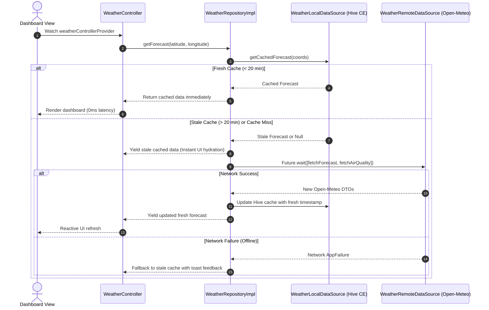
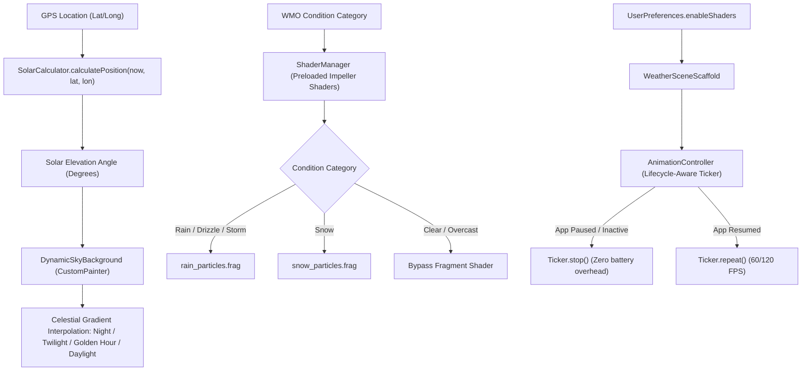
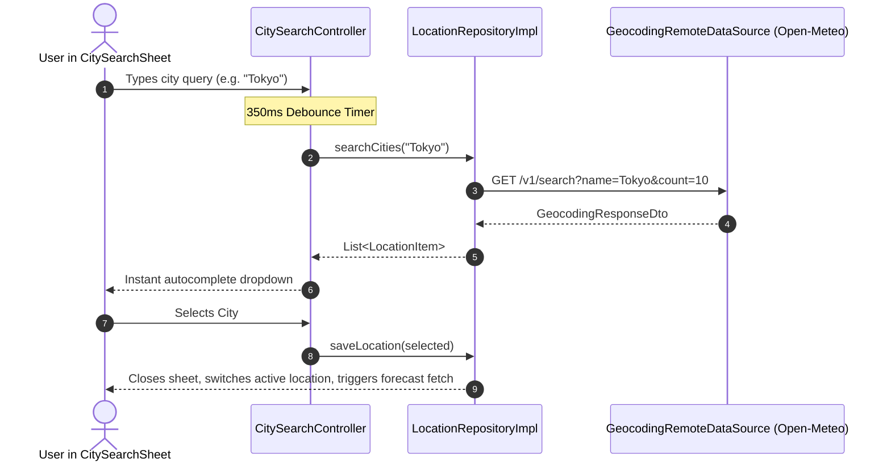
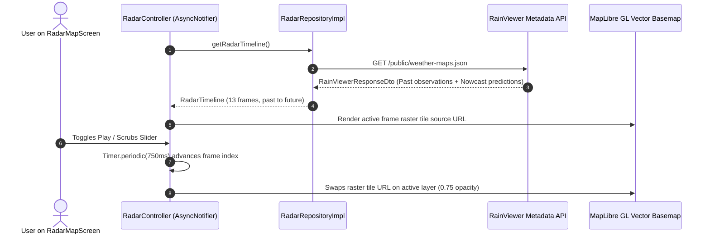

# MetroSky Architecture & Technical Specifications

## 1. Overview
**MetroSky** is a Next-Gen realistic weather application built with Flutter, targeting high performance (60/120 FPS), visual tactility, offline resilience, and clean separation of concerns inspired by Apple Weather and Overdrop.

---

## 2. Architectural Paradigm
- **Feature-First Clean Architecture**: Slices features vertically into `presentation`, `domain`, and `data` layers:
  - `domain`: Pure business logic, immutable entities (`freezed`), repository contracts, and failure definitions. Zero framework dependencies.
  - `data`: DTO models, Hive CE local cache adapters, Dio remote data sources, and repository implementations.
  - `presentation`: Riverpod `AsyncNotifier` controllers, presentation state models, and reusable UI widgets.
- **Core Layer (`lib/core/`)**: Houses cross-cutting concerns (Network, Persistence, Theme, Router, Shaders, Utils, and Global Design System Widgets).
  - Designed for **global reusability** with clear, intentional naming conventions.
  - Prohibits raw Material overrides (`AppGlassCard`, `AppIconButton`, `AppShimmerPlaceholder`, `AppErrorStateView`).
- **State Management**: `flutter_riverpod` (v2.0) with code generation and declarative `AsyncNotifier`.
- **Data Modeling & Serialization**: `freezed` with `json_serializable` for compile-time immutability and union states.
- **Offline Storage**: `hive_ce` / `hive_ce_flutter` implementing Stale-While-Revalidate (SWR) caching with 20-minute freshness TTL.

---

## 3. Core Architectural Data Flows

### A. Stale-While-Revalidate (SWR) Caching Flow


---

### B. Visual Realism & Impeller Fragment Shader Pipeline


---

### C. Geocoding & City Search Flow


---

### D. Weather Radar & Scrubber Time Travel


---

## 4. Key Functional Modules

| Feature Module | Key Components | Role |
| :--- | :--- | :--- |
| **`core/`** | `DioClient`, `HiveStorageService`, `AppTheme`, `AppGlassCard`, `AppIconButton`, `AppShimmerPlaceholder`, `AppErrorStateView`, `UnitConverter`, `SolarCalculator`, `TemperatureFormatter` | Global design system, networking interceptors, pure mathematical utilities, and storage |
| **`features/weather/`** | `WeatherRepositoryImpl`, `WeatherController`, `HeroConditionView`, `HourlyTemperatureChart`, `DailyForecastList`, Bento Grid (`UvIndexCard`, `WindCompassCard`, `SunriseSunsetCard`, `AirQualityCard`, `PressureCard`) | Forecast retrieval, SWR caching, 24h temperature chart, Apple Weather range bars, and bento grid metrics |
| **`features/visual_engine/`** | `ShaderManager`, `WeatherSceneScaffold`, `DynamicSkyGradient`, `WeatherShaderPainter`, `rain_particles.frag`, `snow_particles.frag`, `sky_gradient.frag` | Impeller GPU fragment shaders, particle physics, celestial sky canvas, and lifecycle-aware render tickers |
| **`features/location/`** | `LocationRepositoryImpl`, `CitySearchController`, `SavedLocationsController`, `LocationManagementScreen`, `CitySearchSheet`, `ReorderableCityCard` | Open-Meteo geocoding search, GPS device location acquisition, and reorderable saved favorites |
| **`features/radar/`** | `RadarRepositoryImpl`, `RadarController`, `RadarMapScreen`, `RadarTimeScrubber`, `MaplibreMap` | RainViewer real-time radar scans, nowcast frames, vector dark basemaps, and interactive time scrubber |
| **`features/settings/`** | `SettingsRepositoryImpl`, `SettingsController`, `SettingsScreen`, `UserPreferences` | Temperature (°C/°F), wind (km/h, mph, m/s), pressure (hPa, inHg), and GPU shader power-saver toggles |

---

## 5. Verification & Test Suite

The project enforces **0 Errors and 0 Warnings** across all static analysis checks and is covered by **41 automated tests**:
```bash
# Automated static verification
fvm flutter analyze

# Full automated test suite
fvm flutter test
```

### Test Coverage Highlights:
- **Core Utilities**: 100% boundary testing for `SolarCalculator`, `DateFormatter`, `TemperatureFormatter`, and `UnitConverter`.
- **Data & DTOs**: Columnar JSON parsers for Open-Meteo forecast, Open-Meteo Air Quality, Geocoding autocomplete, and RainViewer timelines.
- **Repositories**: SWR cache freshness checks, TTL expiry, fallback on network outages, duplicate location deduplication, and list reordering.
- **Presentation & Controllers**: Radar scrubber time-step controls, settings unit toggles, and widget tree mounting tests for Dashboard, Location Management, Radar Scrubber, and Settings screens.
